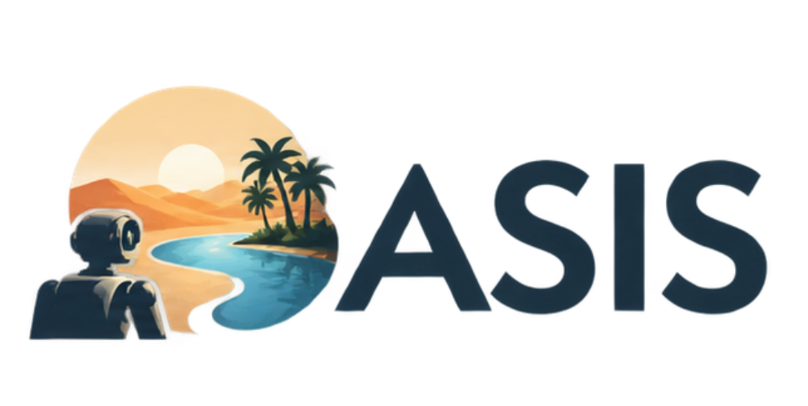
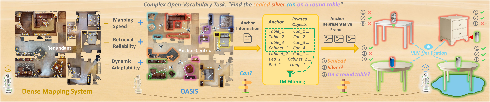

<p align="center">
  
</p>

<h1 align="center">OASIS</h1>
<h3 align="center">Online Anchor-centric Scene Inference System<br>for Open-Vocabulary Retrieval and Navigation in Dynamic Environments</h3>

<p align="center">
  <a href="https://oasis-mm2026-project.balmybean65.chatgpt.site">Project Page</a> ·
  <a href="https://oasis-mm2026-project.balmybean65.chatgpt.site/assets/OASIS-paper.pdf">Paper</a> ·
  <a href="#installation">Installation</a> ·
  <a href="#run-on-replica">Quick Start</a> ·
  <a href="docs/getting-started.zh-CN.md">中文运行指南</a>
</p>

<p align="center"><strong>Kaiyao Liao · Qingfeng Li · Chen Chen · Xiaoze Wu · Qing Sun · Jianwei Niu</strong></p>

<p align="center">
  
</p>

## Overview

**OASIS** helps a robot remember its surroundings, find objects described in natural language, and navigate when the scene changes. Instead of treating every observation equally, it organizes multimodal scene memory around stable semantic anchors such as beds, tables, and sofas.

- **Anchor-centric memory:** retain informative representative views and associate nearby objects with stable 3D anchors.
- **Language-guided retrieval:** an LLM selects relevant anchors; a VLM checks their visual evidence against the task.
- **Dynamic recovery:** a transient visual buffer records recent observations to support finding objects that have moved.

The teaser illustrates a query such as “Find the sealed silver can on a round table”: anchor information narrows the search, and visual verification distinguishes similar candidates.

## Installation

### 1. Clone and create an environment

The commands below target Linux with an NVIDIA GPU. The current local environment uses **Python 3.12**, **PyTorch 2.9.0**, **torchvision 0.24.0**, and **NumPy 1.26.4**. The dependency file preserves its key vision-library versions; it is not a complete environment lockfile.

```bash
git clone https://github.com/starry-curry-30/OASIS.git
cd OASIS
conda create -n oasis python=3.12 tk pip -y
conda activate oasis
python -m pip install --upgrade pip setuptools wheel
```

The repository is currently private, so cloning requires GitHub access. Run the following commands from the repository root.

### 2. Install PyTorch and project dependencies

For a driver compatible with CUDA 12.8:

```bash
python -m pip install torch==2.9.0 torchvision==0.24.0 --index-url https://download.pytorch.org/whl/cu128
python -m pip install -r requirements.txt
```

Select a wheel compatible with your driver using the [official PyTorch installation instructions](https://pytorch.org/get-started/previous-versions/#v290). The code defaults to `device: cuda`; a CPU-only installation is not the documented mapping configuration.

### 3. Install MobileCLIP

The default image encoder is `MobileCLIP-S2` with `datacompdr` weights. Install the MobileCLIP source revision used by the existing local checkout:

```bash
mkdir -p 3rdparty
git clone https://github.com/apple/ml-mobileclip.git 3rdparty/mobileclip
git -C 3rdparty/mobileclip checkout 1140b8d197e4ed7d56b3a92216ded98bb1c2ac87
python -m pip install --no-deps -e 3rdparty/mobileclip
```

`--no-deps` keeps the PyTorch/torchvision pair installed above; the remaining runtime dependencies are listed in `requirements.txt`. See the [official MobileCLIP repository](https://github.com/apple/ml-mobileclip) for encoder details. OpenCLIP downloads the configured pretrained weights on first use, so allow network access or prepare its model cache in advance.

### 4. Prepare model weights

Download the weights through the corresponding model providers and place them as follows:

```text
model/
├── yolov8l-world.pt
├── mobile_sam.pt
└── FastSAM-s.pt
```

- `yolov8l-world.pt`: [YOLO-World](https://docs.ultralytics.com/models/yolo-world/).
- `mobile_sam.pt`: [MobileSAM](https://docs.ultralytics.com/models/mobile-sam/).
- `FastSAM-s.pt`: [FastSAM](https://docs.ultralytics.com/models/fast-sam/); used when `use_fastsam=true`.

The exact filenames come from `config/system_config.yaml`. If you store weights elsewhere, update `yolo.model_path`, `sam.model_path`, and `fastsam.model_path` there. Weights and datasets are not included in this repository.

### 5. Check imports and configuration

```bash
python -c "import torch, open3d, faiss, open_clip, mobileclip; print('CUDA available:', torch.cuda.is_available())"
python -m applications.runner_dataset --cfg job --resolve
```

The second command prints the composed Hydra configuration without loading a dataset or initializing models. Confirm that `CUDA available` is `True` before running GPU mapping.

## Run on Replica

### 1. Prepare RGB-D data and poses

Use the rendered Replica RGB-D layout described by [NICE-SLAM](https://github.com/cvg/nice-slam#replica), rather than only the raw Replica scene meshes:

```text
dataset/Replica/
└── room0/
    ├── traj.txt
    └── results/
        ├── frame000000.jpg
        ├── depth000000.png
        ├── frame000001.jpg
        └── depth000001.png
```

The loader expects naturally sorted `frame*.jpg` and `depth*.png` pairs, with one flattened 4×4 camera-to-world pose per line in `traj.txt`. `scene_id=room_0` resolves to the directory `room0`. Camera intrinsics and the PNG depth scale are configured in `config/data_config/dataset/replica.yaml`; change them if your data uses different calibration or depth units.

### 2. Set paths for your scene

Edit the corresponding fields in `config/base_config.yaml`:

```yaml
dataset_name: replica
scene_id: room_0
dataset_path: ./dataset/Replica
dataset_conf_path: config/data_config/dataset/replica.yaml
representative_frames_path: ./output/representative_frames/replica_room_0
output_path: ./output/map_results
run_oasis_ablation: false
```

Use an absolute `dataset_path` if the data is stored outside the repository. The retrieval scripts also read this file, so keep these paths consistent with the map you build. `run_oasis_ablation=false` runs the ordinary mapping workflow without requiring separate evaluation ground truth.

### 3. Build the map

```bash
python -m applications.runner_dataset \
  use_rerun=false \
  use_parallel=false \
  run_oasis_ablation=false \
  keyframe_image_save.output_dir=output/keyframes/replica_room_0
```

For a short pipeline check, append `end=180 stride=18`. This processes only a subset of frames and is not a full scene or paper-result reproduction. After checking the sequential workflow, set `use_parallel=true` if desired. Enable `use_rerun=true` for visualization when a viewer/display is available.

With the paths above, outputs include:

- `output/map_results/replica_room_0/map/`: saved object map and scene geometry.
- `output/representative_frames/replica_room_0/anchor_key/`: representative views, `manifest.json`, and `anchor_attached_objects.txt`.
- `output/keyframes/replica_room_0/`: exported keyframe images.
- `output/map_results/replica_room_0/`: timing CSV files.

Map and keyframe exporters can replace existing files in their configured output directories. Use a separate output/representative-frame/keyframe directory for each experiment you want to retain. A short or anchor-free sequence may not produce enough stable anchors for retrieval.

## Language-guided retrieval

First finish mapping and confirm that `manifest.json` and `anchor_attached_objects.txt` exist. Keep `config/base_config.yaml` pointed at that scene's saved map and representative frames.

The current runner uses an OpenAI-compatible text service for anchor selection and the Gemini helper in `utils/gemini_vlm.py` for visual verification. Set credentials in your terminal:

```bash
export OPENAI_API_KEY="<your-text-service-api-key>"
export GEMINI_API_KEY="<your-gemini-api-key>"
# Optional: a compatible text-service endpoint
# export OPENAI_BASE_URL="https://your-provider.example/v1"
```

Choose model IDs available to your accounts using `--model` and `--vlm-model`; the script's defaults may not be available to every account. These commands make external API calls and may incur the providers' normal usage charges. Credentials are read from environment variables; `.env` files are not automatically loaded.

```bash
python scripts/anchor_task_runner.py \
  "Find the sealed silver can on a round table" \
  --anchor-file output/representative_frames/replica_room_0/anchor_key/anchor_attached_objects.txt \
  --manifest output/representative_frames/replica_room_0/anchor_key/manifest.json
```

For multiple tasks, create a UTF-8 file with one task per line:

```bash
python scripts/anchor_task_runner.py --tasks-file scripts/batch_tasks.txt
```

The runner reads configuration from this OASIS checkout by default and writes results under `output/query_results/`, including `predictions.json`. `OASIS_ROOT` can override the configuration/data root; `DUALMAP_ROOT` is retained as a legacy override. Do not leave either variable pointing at an unrelated checkout.

To inspect the saved map with the interactive CLIP-based offline query application:

```bash
python -m applications.offline_local_map_query \
  map_dir=output/map_results/replica_room_0/map
```

This application needs a graphical session for its visualizations.

## ROS and live inputs

ROS is optional for offline dataset mapping and retrieval. To use live robot/simulator streams, install ROS and its Python message packages (`rclpy` or `rospy`, `cv_bridge`, `message_filters`, and the standard sensor/navigation/geometry messages). Use a Python interpreter compatible with the ROS installation; for example, ROS 2 Humble's Ubuntu 22.04 binaries use Python 3.10, so do not combine them with the Python 3.12 environment above. Create a matching environment and repeat the dependency/MobileCLIP installation steps. See the [ROS 2 Humble installation guide](https://docs.ros.org/en/humble/Installation.html).

Configure RGB, depth, camera-info, odometry topics, intrinsics, and extrinsics in `config/data_config/ros/self_collected.yaml` (or provide another file through `ros_stream_config_path`). For a fresh mapping session:

```bash
source /opt/ros/humble/setup.bash
python -m applications.runner_ros \
  ros_stream_config_path=config/data_config/ros/self_collected.yaml \
  preload_global_map=false \
  preload_layout=false \
  use_rerun=false
```

The default ROS configuration preloads an existing map/layout. For navigation using an existing map, set valid `preload_path` and `representative_frames_path`, then enable the relevant preload flags. Closed-loop navigation additionally requires a running robot/simulator, compatible topics, poses, and a motion controller; launching the Python runner alone does not provide those components. For the simulation bridge, see [Habitat Data Collector](https://github.com/Eku127/habitat-data-collector).

Record3D streaming is another optional input. Install `record3d==1.4.1`, connect a compatible device running Record3D, review `config/runner_record_3d.yaml`, then run:

```bash
python -m applications.runner_record_3d
```

## Evaluation and troubleshooting

- **Evaluation:** scripts such as `scripts/evaluate_anchor_sr3d.py` and `scripts/evaluate_anchor_sr3d_ablation.py` require prepared benchmark scenes, annotations, and maps. Run `python scripts/evaluate_anchor_sr3d.py --help` to inspect the supported arguments. They are not a dataset downloader or a one-command reproduction of all paper results.
- **Missing `mobileclip`:** complete installation step 3 using the same Python interpreter as the runner.
- **CUDA unavailable:** check the NVIDIA driver and the selected PyTorch wheel before running mapping.
- **Missing files under `/path/to/OASIS`:** replace the example paths in `config/base_config.yaml`, `config/runner_dataset.yaml`, or the selected ROS configuration.
- **No anchors or manifest:** check the scene's class list, anchor list, model initialization logs, and sequence length before running retrieval.
- **Display errors:** use `use_rerun=false` and `memory_cluster_live_viz.enabled=false` for headless mapping; interactive map-query windows require a display.
- **API errors:** confirm the keys, endpoint, account model access, and installed `google-generativeai` package. The current Gemini helper uses that SDK; do not replace it with a different SDK without updating the helper.

The current checks cover Python syntax, entry-point loading, CLI help, and Hydra configuration. A clean-environment installation and the complete mapping/navigation experiments have not yet been validated for this release.

## Repository structure

```text
OASIS/
├── oasis/          # Core online inference system
├── applications/   # Dataset, ROS, Record3D, offline-query entry points
├── config/         # Models, datasets, classes, navigation, visualization
├── scripts/        # Retrieval, navigation, evaluation, analysis
├── utils/          # Mapping, detection, tracking, memory, visualization
├── docs/           # Logo, teaser, and Chinese getting-started guide
└── requirements.txt
```

## Acknowledgments

The implementation builds on components from [DualMap](https://github.com/Eku127/DualMap), [Ultralytics](https://github.com/ultralytics/ultralytics), [OpenCLIP](https://github.com/mlfoundations/open_clip), and [MobileCLIP](https://github.com/apple/ml-mobileclip). Please follow the respective licenses and dataset/model terms when using their code or assets.

## Citation

```bibtex
@inproceedings{liao2026oasis,
  title     = {OASIS: Online Anchor-centric Scene Inference System
               for Open-Vocabulary Retrieval and Navigation
               in Dynamic Environments},
  author    = {Liao, Kaiyao and Li, Qingfeng and Chen, Chen
               and Wu, Xiaoze and Sun, Qing and Niu, Jianwei},
  booktitle = {Proceedings of the 34th ACM International
               Conference on Multimedia},
  year      = {2026},
  doi       = {10.1145/3767308.3835228}
}
```
